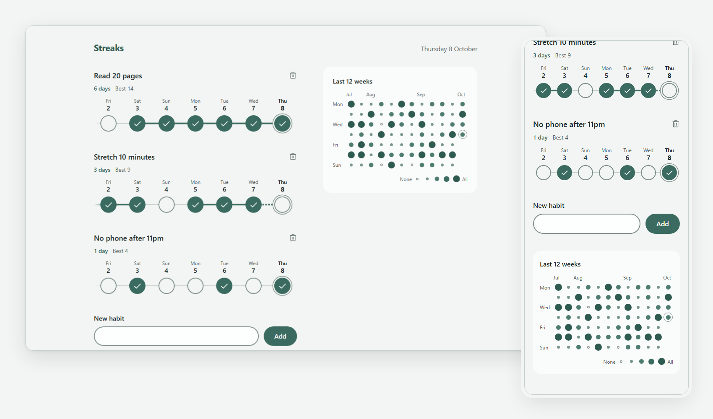
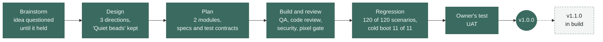

<p align="center">
  <picture>
    <source media="(prefers-color-scheme: dark)" srcset="docs/brand/lockup-dark.svg">
    
  </picture>
</p>

<p align="center">
  A calm daily habit tracker. Tick the days you kept a habit and watch the thread grow.<br>
  No account, no server, no network call. Everything stays in your browser.
</p>

<p align="center">
  
  
  
  
</p>

<p align="center">
  
</p>
<p align="center"><sub>Real captures of the built app, taken by the pixel gate at 1280 x 800 and 390 x 844. Each one matches its approved design screen with 0 mismatched pixels.</sub></p>

> The logo, badges and captures above show the sealed 1.0.0, named Streaks. Version 1.1.0, named Danial's
> Streaky Habit, is in build and replaces them when it is sealed. The sections below describe the code as it
> stands in 1.1.0.

## What it does

- **Add a habit**, up to 12, each with a name of up to 40 characters. A name error shows above the field when you press Add, and typing clears it.
- **Done today.** Each habit row has a Done today button. Press it again to untick today.
- **Current and Best.** Each row shows the current streak and the best one, each with its label.
- **Edit any past day, up to 12 months back.** Tap a day in the overview to open the day editor, a list of every habit with a tick for that day.
- **A habit's year.** A row's Year button opens that habit's last 12 months. Tap a day to mark it done or not done. Delete habit is here too.
- **The overview.** On a wide screen a band shows the last 12 weeks as rings, one segment per habit, lit when it was done, with a full core on a day every habit was done. On a phone the Overview button in the header opens the same view as a popup. Its Year button shows every habit over the last 12 months.
- **Every view at once.** An edit from any place saves once and updates every row, ring and open popup.
- **Delete with a confirm**, from a row's bin or from the habit's year.
- **Keep it on this device.** Saved in `localStorage` after every change, read once when the page opens. If saving fails, a warning says so.

## How it was built

Built end to end by **sdlc**, the author's own multi-agent pipeline for Claude Code. Agents brainstorm, design, plan, build
and review. Separate finder agents test, review and audit the work and never fix it. Solver agents fix what the finders report,
and the orchestrator rules on anything in between. A person tests the result and seals each version. No agent can.



Every decision, finding and fix is dated in the version's change ledger, with who made it,
[`docs/v1.0.0/CHANGE-LEDGER.md`](docs/v1.0.0/CHANGE-LEDGER.md) for 1.0.0 and
[`docs/v1.1.0/CHANGE-LEDGER.md`](docs/v1.1.0/CHANGE-LEDGER.md) for 1.1.0. Some of what the 1.0.0 reviews caught on the way.

| Found by | What it was | What happened |
|---|---|---|
| Security review | A habit name with hidden text-direction characters could reorder the delete question | The dialog title now leaves those characters out of its copy of the name |
| Security review | A fast double click could open the delete dialog and confirm it in one gesture | Two guards of half a second each. v1.1.0 replaces one with a guard that does not depend on time |
| Code review | Tests of that half second did not pin its edge | The tests now press at 499 ms (ignored) and 1 ms later (acts) |
| Regression | Every scenario of both modules, again, on the final code | 120 of 120 pass, and the app works from a cold boot with real clicks |

## Versions

| Version | State | What changed |
|---|---|---|
| **1.0.0** | Sealed by the owner 2026-10-10, tag `v1.0.0` | First release. Add, tick the week, current and best streak, 12-week heatmap, delete with confirm, saved on the device |
| **1.1.0** | In build, not sealed | Edit any past day up to 12 months back, Done today, a year view per habit and one for all habits, the overview drawn as rings. Current and Best labelled. A delete guard that does not depend on time. A warning when habits cannot be saved. Tested in WebKit, Safari's engine, as well as Chromium. The new logo in the app and as the tab icon, a new amber look, and the name Danial's Streaky Habit |

Each sealed version gets a `SEAL.md`, a git tag, and a read-only folder under `docs/`.

## Run it

```
python -m http.server 8000 --bind 127.0.0.1
```

Run that from the project root, then open `http://127.0.0.1:8000/`. Stop the server when you are done.
Any static host works. There is no build step and nothing to install.

## Behaviour worth knowing

- "Delete habit" ignores a mouse or touch click that lands inside the box of the button that opened the dialog, and the second click of a double click. A key press on it always acts. Nothing waits on time.
- For half a second after a mouse or touch click inside a popup, a click on the page or on a popup beneath it is ignored. Closing a popup with the keyboard starts no wait.
- Esc closes the top popup only. On a phone that is the day editor first, then the year view, then the overview.
- The day editor shows each habit's streak numbers for today, not as of the chosen day.
- The page moves to a new day on its own, checked every 30 seconds and when the tab is shown again, and redraws every open popup.

## Known limits

Each was found and accepted on purpose. The reasoning is in the ledgers, `docs/modules/app/spec.md` (threat
model notes) and `docs/modules/app/findings/security.md`.

| Limit | Since | Status |
|---|---|---|
| A slow double click (more than half a second between clicks) where the trash button and "Delete habit" overlap can still delete | 1.0.0 | fixed in 1.1.0 by the guard in Behaviour worth knowing |
| Another page on the same `github.io` origin can read the saved names | 1.0.0 | kept, no way to isolate it on that host |
| Two open tabs do not see each other's changes, and the last save wins | 1.0.0 | kept, one tab at a time by design |
| If storage is blocked or full, changes stay on screen but are not saved, with no message | 1.0.0 | 1.1.0 shows a warning while saving fails |
| Private browsing, Safari's 7-day clean-up of site data and clearing site data lose every habit, with no failure the page can see | 1.1.0 | kept, the browser reports nothing the page could show |
| A name made of many combining marks draws over its neighbours | 1.0.0 | kept, cosmetic, typed by the user or planted by another page on the same origin |
| With the device clock set to the year 10000 or later, the app saves a day it cannot read back, and the next load resets every habit. In 1.1.0 the year views also do not open | 1.0.0 | kept |
| In a desktop browser window narrower than 768 px with classic scrollbars, the overview popup shows a thin scrollbar while the day editor is open over it | 1.1.0 | kept, the room that keeps the chosen day in sight makes the popup scroll |
| Only Chromium is tested. Safari and Firefox are not verified | 1.0.0 | 1.1.0 tests Chromium and WebKit, Safari's engine. Firefox is not verified |

<details>
<summary><b>How it is built</b></summary>

Vanilla JavaScript ES modules and plain CSS. Zero dependencies, no framework, no web fonts.

**`habit-logic`** (`src/dates.js`, `src/habits.js`) holds every rule about days and streaks. Days are local
calendar dates written `YYYY-MM-DD`.
- `localDateKey`, `addDays`, `longDate`, `yearDate`, `monthTitle` and the other date helpers work on those keys.
- `toggleDay`, `currentStreak` and `bestStreak` drive Done today, every tick and the streak line.
- `doneFlags` gives every habit's done flag for one day, which the rings draw. `yearStart` and `yearMonths` lay out the last 12 months of the year views. `heatmapCells` and `monthLabels` lay out the 12-week overview.
- `validateName`, `addHabit` and `deleteHabit` keep the list valid, at most 12 habits (`MAX_HABITS`) with names up to 40 characters (`MAX_NAME_LENGTH`).

**`app`** (`index.html` and the rest of `src/`) is the page.
- `src/app.js` boots the page (`boot`) and handles every gesture. `readToday` is the only place the clock is read. After every edit, `edit` saves once (`saveHabits`) and `render` redraws every view and every open popup. `checkDay` moves the page to a new day every 30 seconds (`DAY_CHECK_MS`) and when the tab is shown again.
- `src/view.js` owns the page's selectors and draws the main column, the rows (`renderRows`), the streak line (`renderStats`), the composer and the two banners (`renderSaveWarning`, `showResetNote`).
- `src/calendar.js` draws the rings and day grids of the overview band and popup (`drawOverview`) and of the year views (`drawHabitYear`, `drawAllHabitsYear`). `src/ring.js` holds the ring geometry (`arcPath`, `legendCounts`).
- `src/popups.js` fills the five popups (`renderDayEditor`, `renderHabitYear`, `renderOverviewPopup`, `renderAllHabitsYear`, `renderDeleteTitle`) and names the first focus of each (`openFocusOf`). On a phone, when the day editor opens over the overview, `keepDayInSight` gives that popup room so the chosen day stays in sight, and `clearDayRoom` takes the room back when the editor closes.
- `src/storage.js` saves and loads the list (`STORAGE_KEY`, `encodeState`, `decodeState`, `loadHabits`, `saveHabits`). `saveHabits` reports whether the save worked.
- Every popup opens with `showModal()`. `onPopupClose` decides what a close does next, focus back to the control that opened it, or to `firstFocusOfTopLayer` when that control is gone. The delete guard is `isStrayPress`. `guardTapThrough` is the tap-through guard (`TAP_THROUGH_MS`), registered first, for the capture phase.
- The delete dialog's title wraps the name in an isolate and leaves the name's text-direction control characters out of that copy (`TITLE_STRIPPED`), so a crafted name cannot reorder the question. The saved name is unchanged.
- `src/icon.svg` is the tab icon.

**The look.** `src/styles.css` is the approved design's stylesheet (`docs/design/system.css` without its golden
stand-ins) with three marked rule changes. No other CSS is added.

</details>

<details>
<summary><b>Test it</b></summary>

| What | Command | Evidence |
|---|---|---|
| Unit tests | `node --test "tests/**/*.test.js"` | none |
| Browser tests, Chromium | `python -m pytest tests/browser -q` | none unless `STREAKS_EVIDENCE_DIR` is set |
| Browser tests, WebKit | `python -m pytest tests/browser -q --engine webkit` | none unless `STREAKS_EVIDENCE_DIR` is set |
| Works right (live gate) | `python tests/browser/live_e2e.py --engine <chromium or webkit> --base-url http://127.0.0.1:<port>/ --out docs/modules/app/qa/live-e2e/<ts>-<engine>/` | that folder |
| Live gate control | the same command with `--out docs/modules/app/qa/live-e2e/<ts>-<engine>-control/ --control seeded`, which must stop red at the first-visit step | that folder |
| Looks right (fidelity gate) | the sdlc harness commands in `docs/modules/app/qa.md`, Fidelity gate | `docs/modules/app/qa/fidelity-<screen>-<viewport>/<ts>/` |

Node 24, Python with pytest and Playwright, headless Chromium and WebKit. Tests marked `chromium_only` are
skipped in WebKit with a reason. The browser tests start and stop their own local servers. The live gate
needs the app already served, so start a server first and stop it after. A bare `node --test tests/` fails
on Node 24, so keep the quoted glob. Every time-dependent test controls the clock with Playwright's clock
API, never with a hook in the app.

At v1.0.0, 179 browser tests and 99 unit tests pass. The 1.1.0 counts are written at its seal.

</details>

<details>
<summary><b>Saved data and security</b></summary>

One key, `streaks.state` in `localStorage`, holding `{ "version": 1, "habits": [...] }`. It is saved after
every add, tick and delete, and read once at boot.

`decodeState` treats the stored text as untrusted and accepts it only under the readable rule in
`docs/modules/app/spec.md` (Contracts). Anything else resets the list to empty and shows a short note
saying so. If storage is blocked or full, the page keeps working in memory and shows a warning that changes
are not being saved. A browser that drops site data on its own reports nothing, see Known limits.

- Habit names reach the page only as text. `src/` contains no `innerHTML`, `eval` or similar, and the page adds nothing to `window`.
- The page carries a Content Security Policy.
  ```
  default-src 'self'; script-src 'self'; style-src 'self' 'unsafe-inline'; connect-src 'none'; object-src 'none'; base-uri 'none'; form-action 'none'
  ```
- Nothing leaves the device. The browser suite checks that, through any use of the app, the only requests are same-origin GETs for the page's own files.
- **Publish only `index.html`, `src/` and a `.nojekyll` file.** Never serve the repository root. It holds build records, screenshots, local paths and deliberate mutant copies of `src/` used to prove the tests can fail.

</details>

## Where the record lives

- [`docs/v1.0.0/CHANGE-LEDGER.md`](docs/v1.0.0/CHANGE-LEDGER.md) and [`docs/v1.1.0/CHANGE-LEDGER.md`](docs/v1.1.0/CHANGE-LEDGER.md) list every scope, decision, finding and fix, dated, with who decided.
- [`docs/regression/REGRESSION.md`](docs/regression/REGRESSION.md) is the last full re-check of the whole app.
- `docs/modules/<module>/spec.md` and `qa.md` hold the requirements and the test contract.
- `docs/modules/<module>/findings/` holds each review's verdict (QA, code review, security, fidelity).
- `docs/modules/<module>/qa/` holds the evidence of every run.
- `docs/design/` holds the approved design screens. They do not change outside the design phase.
- `docs/brand/` holds the logo, the README badges and the showcase image.
