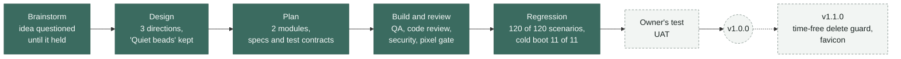

<p align="center">
  <picture>
    <source media="(prefers-color-scheme: dark)" srcset="docs/brand/lockup-dark.svg">
    
  </picture>
</p>

<p align="center">
  A calm daily habit tracker. Tick the days you kept a habit and watch the thread grow.<br>
  No account, no server, no network call. Everything stays in your browser.
</p>

<p align="center">
  
  
  
  
</p>

<p align="center">
  
</p>
<p align="center"><sub>Real captures of the built app, taken by the pixel gate at 1280 x 800 and 390 x 844. Each one matches its approved design screen with 0 mismatched pixels.</sub></p>

## What it does

- **Add a habit**, up to 12, each with a name of up to 40 characters.
- **Tick the week.** Each day is a bead. A run of done days is drawn as one thick thread, and a dashed thread into today says the run still holds.
- **See your streaks.** The current streak and your best one, under each habit.
- **See the last 12 weeks** in one heatmap for all habits. Dots grow with the share of habits done that day.
- **Keep it on this device.** Saved in `localStorage` after every change, read once when the page opens.

## How it was built

Built end to end by **sdlc**, the author's own multi-agent pipeline for Claude Code. Agents brainstorm, design, plan, build
and review. Separate finder agents test, review and audit the work and never fix it. Solver agents fix what the finders report,
and the orchestrator rules on anything in between. A person tests the result and seals each version. No agent can.



Every decision, finding and fix of this version is dated in [`docs/v1.0.0/CHANGE-LEDGER.md`](docs/v1.0.0/CHANGE-LEDGER.md),
with who made it. Some of what the reviews caught on the way:

| Found by | What it was | What happened |
|---|---|---|
| Security review | A habit name with hidden text-direction characters could reorder the delete question | The dialog title now leaves those characters out of its copy of the name |
| Security review | A fast double click could open the delete dialog and confirm it in one gesture | Two guards of half a second each. v1.1.0 replaces one with a guard that does not depend on time |
| Code review | Tests of that half second did not pin its edge | The tests now press at 499 ms (ignored) and 1 ms later (acts) |
| Regression | Every scenario of both modules, again, on the final code | 120 of 120 pass, and the app works from a cold boot with real clicks |

## Versions

| Version | State | What changed |
|---|---|---|
| **1.0.0** | Built and regression checked. Waiting for the owner's test and seal | First release. Add, tick, current and best streak, 12-week heatmap, delete with confirm, saved on the device |
| **1.1.0** | Planned after the 1.0.0 seal | A delete guard that does not depend on time (fixes the slow double-click limit below). The new logo as the favicon. No new features |

Each sealed version gets a `SEAL.md`, a git tag, and a read-only folder under `docs/`.

## Run it

```
python -m http.server 8000 --bind 127.0.0.1
```

Run that from the project root, then open `http://127.0.0.1:8000/`. Stop the server when you are done.
Any static host works. There is no build step and nothing to install.

## Behaviour worth knowing

- "Delete habit" does nothing for the first half second after the dialog opens.
- Right after a mouse or touch press in the dialog, a click on the page behind is ignored for half a second.
- Both come from the double-click guards above.

## Known limits in v1.0.0

Each was found during this version and accepted on purpose. The reasoning is in the ledger,
`docs/modules/app/spec.md` (threat model notes) and `docs/modules/app/findings/security.md`.

| Limit | Planned |
|---|---|
| A slow double click (more than half a second between clicks) where the trash button and "Delete habit" overlap can still delete | fixed in v1.1.0 with a guard that does not depend on time |
| Another page on the same `github.io` origin can read the saved names | kept, no way to isolate it on that host |
| Two open tabs do not see each other's changes, and the last save wins | kept, one tab at a time by design |
| If storage is blocked or full, changes stay on screen but are not saved, with no message | kept |
| A name made of many combining marks draws over its neighbours | kept, cosmetic, typed by the user or planted by another page on the same origin |
| With the device clock set to the year 10000 or later, the app saves a day it cannot read back, and the next load resets every habit | kept |
| Only Chromium is tested. Safari and Firefox are not verified | kept |

<details>
<summary><b>How it is built</b></summary>

Vanilla JavaScript ES modules and plain CSS. Zero dependencies, no framework, no web fonts.

**`habit-logic`** (`src/dates.js`, `src/habits.js`) holds every rule about days and streaks. Days are local
calendar dates written `YYYY-MM-DD`.
- `localDateKey`, `addDays` and the other date helpers work on those keys.
- `weekWindow`, `toggleDay`, `currentStreak` and `bestStreak` drive the week strip and the streak line.
- `heatmapCells`, `heatLevel` and `monthLabels` build the 12-week heatmap.
- `validateName`, `addHabit` and `deleteHabit` keep the list valid, at most 12 habits with names up to 40 characters.

**`app`** (`index.html`, `src/app.js`, `src/view.js`, `src/storage.js`) is the page.
- `src/app.js` boots the page and handles every gesture. `readToday` is the only place the clock is read. `checkDay` rolls the page over to a new day every 30 seconds and when the tab is shown again.
- `src/view.js` owns every selector and builds and updates the page's elements. Rows are rebuilt on add and delete and updated in place on a tick, so focus and the bead animations survive.
- `src/storage.js` saves and loads the list (`STORAGE_KEY`, `encodeState`, `decodeState`, `loadHabits`, `saveHabits`).
- The delete dialog is decided in its `close` event (`onDialogClose`). Two guards stop a double click or double tap from deleting through it. `guardDialogClick` keeps "Delete habit" inert for 500 ms after the dialog opens, and `swallowTapThrough` ignores page clicks for 500 ms after a press inside the dialog (`DIALOG_GUARD_MS`).
- The dialog title wraps the name in an isolate and leaves the name's text-direction control characters out of that copy (`TITLE_STRIPPED`), so a crafted name cannot reorder the question. The saved name is unchanged.

**The look.** `src/styles.css` is the approved design's stylesheet with three marked rule changes. No other
CSS is added.

</details>

<details>
<summary><b>Test it</b></summary>

| What | Command | Evidence |
|---|---|---|
| Unit tests | `node --test "tests/**/*.test.js"` | none |
| Browser tests | `python -m pytest tests/browser -q` | none unless `STREAKS_EVIDENCE_DIR` is set |
| Works right (live gate) | `python tests/browser/live_e2e.py --base-url http://127.0.0.1:<port>/ --out docs/modules/app/qa/live-e2e/<ts>/` | that folder |
| Looks right (fidelity gate) | the sdlc harness commands in `docs/modules/app/qa.md`, Fidelity gate | `docs/modules/app/qa/fidelity-<screen>-<viewport>/<ts>/` |

Node 24, Python with pytest and Playwright, headless Chromium. The browser tests start and stop their own
local servers. The live gate needs the app already served, so start a server first and stop it after.
A bare `node --test tests/` fails on Node 24, so keep the quoted glob. Every time-dependent test controls
the clock with Playwright's clock API, never with a hook in the app.

At v1.0.0, 179 browser tests and 99 unit tests pass.

</details>

<details>
<summary><b>Saved data and security</b></summary>

One key, `streaks.state` in `localStorage`, holding `{ "version": 1, "habits": [...] }`. It is saved after
every add, tick and delete, and read once at boot.

`decodeState` treats the stored text as untrusted and accepts it only under the readable rule in
`docs/modules/app/spec.md` (Contracts). Anything else resets the list to empty and shows a short note
saying so. If storage is blocked or full, the page keeps working in memory without a message.

- Habit names reach the page only as text. `src/` contains no `innerHTML`, `eval` or similar, and the page adds nothing to `window`.
- The page carries a Content Security Policy.
  ```
  default-src 'self'; script-src 'self'; style-src 'self' 'unsafe-inline'; connect-src 'none'; object-src 'none'; base-uri 'none'; form-action 'none'
  ```
- Nothing leaves the device. Every test run checks that the only requests are same-origin GETs for the page's own files.
- **Publish only `index.html`, `src/` and a `.nojekyll` file.** Never serve the repository root. It holds build records, screenshots, local paths and deliberate mutant copies of `src/` used to prove the tests can fail.

</details>

## Where the record lives

- [`docs/v1.0.0/CHANGE-LEDGER.md`](docs/v1.0.0/CHANGE-LEDGER.md) lists every scope, decision, finding and fix, dated, with who decided.
- [`docs/regression/REGRESSION.md`](docs/regression/REGRESSION.md) is the last full re-check of the whole app.
- `docs/modules/<module>/spec.md` and `qa.md` hold the requirements and the test contract.
- `docs/modules/<module>/findings/` holds each review's verdict (QA, code review, security, fidelity).
- `docs/modules/<module>/qa/` holds the evidence of every run.
- `docs/design/` holds the approved design screens. They do not change outside the design phase.
- `docs/brand/` holds the logo, the README badges and the showcase image.
