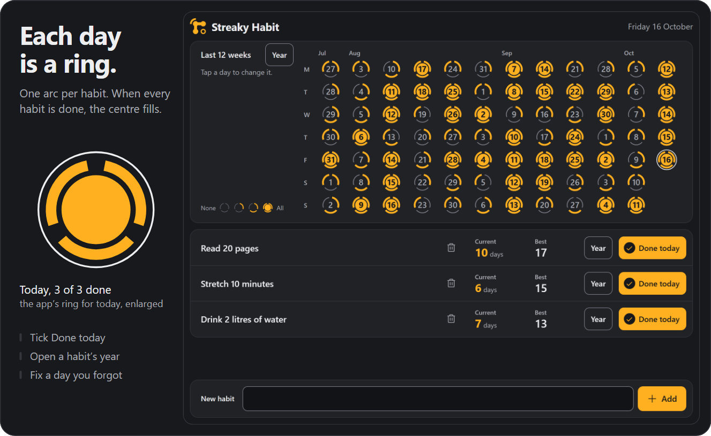
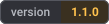
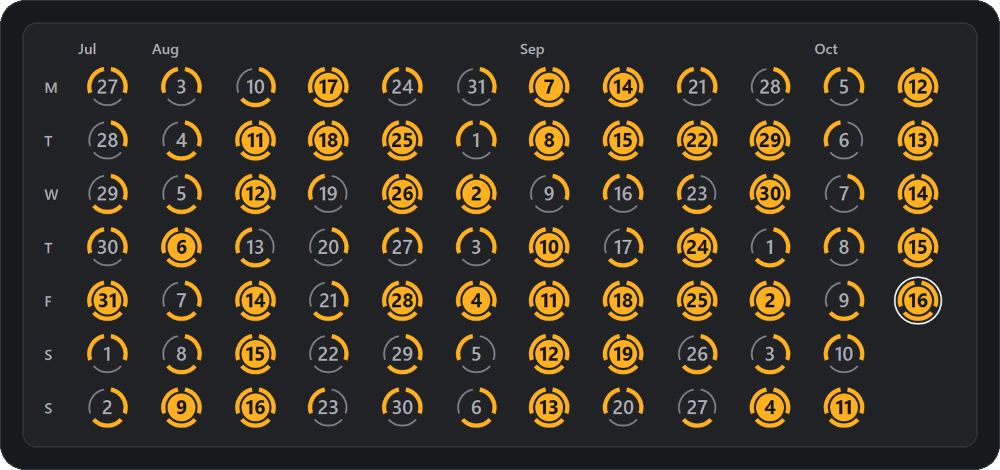
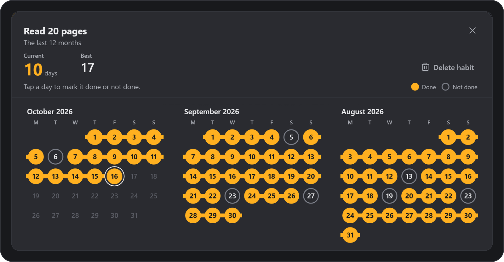
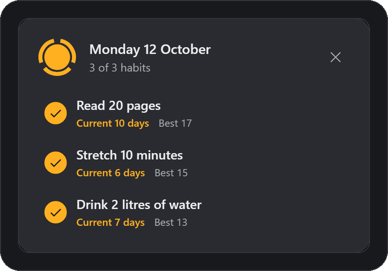
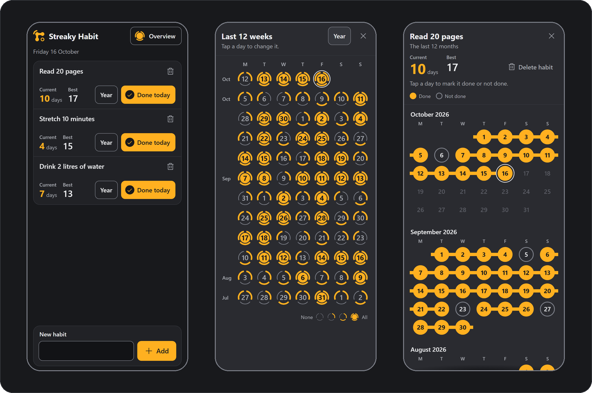

<p align="center"></p>

<h1 align="center">Danial's Streaky Habit</h1>

<p align="center">Keep your daily habits in view, one ring a day, with everything saved in your own browser.</p>

<picture>
  <source media="(prefers-reduced-motion: reduce)" srcset="docs/readme/hero-still.png">
  
</picture>

<p align="center"><sub>Recorded from the running app in headless Chromium at 1024 x 800. Every habit and tick was entered with mouse and key events. The panel on the left is an overlay added for the recording. The white circle marks each click.</sub></p>

<p align="center">
  <a href="https://softdevdanial.github.io/streaky-habit/"></a>
  &nbsp;
  <a href="#run-it-on-your-machine"></a>
</p>

<!-- SHOWCASE_URL is a placeholder. Replace it with the address of the showcase hub once it exists, keeping each #anchor. -->
<p align="center"><sub>Made with sdlc, a multi-agent pipeline for Claude Code that I designed. <a href="SHOWCASE_URL#streaky-habit">See how it was built</a>.</sub></p>

<p align="center">
  
  
  
  <a href="SHOWCASE_URL#streaky-habit-tests"></a>
  <a href="SHOWCASE_URL#streaky-habit-tests"></a>
</p>

## What it does

Streaky Habit puts every habit for a day into one ring, so a partly done day stands out at a glance.

### The last 12 weeks

Each day is a ring with one arc per habit. An arc lights up when that habit is done, and the centre fills on days when every habit is done.

Tap any day to see and change what you did.

<p align="center"></p>

### A year for each habit

A habit's **Year** button opens its last 12 months, with done days shown as beads on a thread. Tap a day to mark it done or not done. Delete a habit from its row or its year view, and the app asks you to confirm first.

The **Year** button beside **Last 12 weeks** opens **All habits**, the same rings for every day of the last 12 months.

<p align="center"></p>

### Fix a day you forgot

Open any past day up to 12 months back and tick what you did. Every row, ring and open popup updates at once.

<p align="center"></p>

## How streaks count

- A day is your device's local calendar day. The app moves to the new day on its own, checking every 30 seconds and whenever the tab is shown again.
- Your current streak counts the days in a row you did the habit, up to today, or up to yesterday while today is still open. So a streak does not break until the day is over.
- Your best streak is the longest run of days in a row in all your saved days.
- The app stores no start date for a habit, so you can tick days before you added it. It also means a new habit counts on every past day in the overview, so days that were full before you added it no longer show a full centre.

## On your phone

<p align="center"></p>

On a phone, the 12-week overview opens from the **Overview** button in the header, and each habit's year view fills the screen.

<p align="center"><sub>Captured in a 390 x 844 phone layout in headless Chromium.</sub></p>

## Your data stays with you

<table>
  <tr>
    <th width="50%">No account</th>
    <th width="50%">No server</th>
  </tr>
  <tr>
    <td>Nothing to sign up for and nothing to log in to.</td>
    <td>The app is a static page, so any static host can serve it as it is.</td>
  </tr>
  <tr>
    <th>No network calls</th>
    <th>Saved in this browser only</th>
  </tr>
  <tr>
    <td>The app makes no network requests. The browser tests check that the only requests are same-origin GETs for the app's own files.</td>
    <td>Your habits are kept in <code>localStorage</code> and saved after every change, so a reload or a closed tab loses nothing. Clearing the site's data removes them.</td>
  </tr>
</table>

## What's new in 1.1

- Edit any past day, up to 12 months back.
- A **Done today** button on every habit.
- A year view for each habit, and **All habits** for every habit at once.
- The overview drawn as rings, one arc per habit.
- Current and best streaks are now labelled.
- A safer delete, so a slow double click can no longer delete a habit by mistake.
- A warning shows when habits cannot be saved.
- Tested in WebKit, Safari's engine, as well as Chromium.
- A new name (1.0 was called Streaks), a logo in the app and as the tab icon, and a new amber look chosen from five design directions.

Planned next are a fix for the known bug below and unlimited habits, each in its own colour. Both are written up in [`docs/future/`](docs/future/).

## Good to know

**A known bug.** In desktop browsers that show classic scrollbars, such as Chrome on Windows, the **All habits** view shows two months per row instead of the three in the design. The fix is planned for the next version, and the [showcase](SHOWCASE_URL#streaky-habit) tells how it was found.

- Your habits are lost without warning in private browsing, after Safari's 7-day limit on stored site data, or when site data is cleared. The browser gives the page no signal in any of these.
- If storage is blocked when the page opens and is allowed again without a reload, the next change overwrites the saved habits with the shorter list on screen. Reloading first prevents this. This is not fixed in 1.1.0. The save warning stays on screen the whole time storage is blocked.
- Changes in one tab do not appear in another open tab. The last save wins.
- Any other page on the same `<user>.github.io` origin can read and change your saved habits, including my other projects there.
- At most 12 habits, each name up to 40 characters.
- Tested in Chromium and WebKit, Safari's engine. Firefox is not tested. Phone layouts were checked by automated tests in emulation. The manual iPhone tests were not run, so they are not counted as passed.

<details>
<summary><b>Every known limit, in full</b></summary>

Each limit below was found in testing. Its status says whether it was fixed in 1.1.0, is by design, is an accepted low risk, is planned for the next version, or comes from the browser or the host. The [showcase](SHOWCASE_URL#streaky-habit) explains each call, and the records are in [`docs/`](docs/).

| Limit | Found in | Status |
|---|---|---|
| Private browsing, Safari's 7-day limit on stored site data and clearing site data lose every habit. The browser reports nothing, so no warning shows | 1.1.0 | Browser limit, the page cannot detect it |
| If storage is blocked when the page opens and is allowed again without a reload, the next change overwrites the saved habits with the shorter list on screen. Reloading first prevents this | 1.1.0 | Not fixed in 1.1.0. The save warning stays on screen the whole time storage is blocked |
| If storage is blocked or full, changes stay on screen but are not saved, with no message | 1.0.0 | Fixed in 1.1.0. A warning shows while saving fails |
| In desktop browsers that show classic scrollbars, such as Chrome on Windows, the **All habits** view shows two months per row instead of the three in the design | 1.1.0 | Planned for the next version ([how it was found](SHOWCASE_URL#streaky-habit)) |
| Changes in one tab do not appear in another open tab. The last save wins | 1.0.0 | By design |
| Any other page on the same `<user>.github.io` origin, my other projects included, can read and change the saved habits, and the page can be framed. GitHub Pages cannot set the headers that would isolate the page or stop it being framed | 1.0.0 | GitHub Pages limit |
| A slow double click (more than half a second between clicks) where the bin icon and the **Delete habit** button overlap could delete the habit | 1.0.0 | Fixed in 1.1.0 by the guard described under **Behaviour worth knowing** below |
| At most 12 habits. The new-habit input is disabled at 12 | 1.0.0 | By design. Lifting it is planned for the next version (`docs/future/unlimited-habits.md`) |
| On a phone with nine or more habits, the day editor reaches its full height and can partly cover the chosen day | 1.1.0 | Planned for the next version. The unlimited habits upgrade redesigns the day editor's list |
| In a desktop browser window narrower than 768 px with classic scrollbars, the overview popup shows a thin scrollbar while the day editor is open over it. The extra space that keeps the chosen day visible makes the popup scroll | 1.1.0 | By design |
| In Safari's engine, a popup opened by a tap shows the keyboard focus ring on its first control. Chrome shows none, and neither does the design | 1.1.0 | Safari behaviour, not checked on a real iPhone |
| Only Chromium is tested | 1.0.0 | Fixed in 1.1.0, which also tests WebKit, Safari's engine |
| A name made of many combining marks draws over its neighbours. It is cosmetic and can only come from the user or another page on the same origin | 1.0.0 | Accepted, low risk |
| With the device clock set to the year 10000 or later, ticking and the year views stop working, but no data is lost | 1.0.0 | Accepted, low risk |

**Behaviour worth knowing**

- **Delete habit** ignores a click or tap that lands where the button that opened the dialog was, and ignores the second click of a double click. A key press always works. This guard uses no timer.
- For half a second after a mouse or touch click inside a popup, a click on the page or on a popup beneath it is ignored. Closing a popup with the keyboard starts no pause.
- Esc closes the top popup only. On a phone that is the day editor first, then the year view, then the overview.
- The day editor shows each habit's streaks as of today, not as of the chosen day.

</details>

## How it was built

Danial's Streaky Habit was made with [sdlc](SHOWCASE_URL), a multi-agent pipeline for Claude Code. I designed the pipeline and every agent in it. Claude builder agents wrote the code from approved specs, separate checking agents tested and reviewed it without being allowed to fix anything, fixing agents repaired what they found, and only I can release a version. I made or approved every product decision and tested each version myself before release. The [showcase](SHOWCASE_URL#streaky-habit) shows what the checking agents caught, what they missed, and where my verdict differed from theirs. The records are in [`docs/`](docs/).

Its sister app, [Danial's Splity Tab](https://github.com/SoftDevDanial/splity-tab), was made the same way.

## Run it on your machine

```sh
python -m http.server 8000 --bind 127.0.0.1
```

Run that from the project root, then open `http://127.0.0.1:8000/`.

Vanilla JavaScript ES modules and plain CSS. No runtime dependencies and no build step, so running the app needs only a static file server. To host it, publish only `index.html`, `src/` and a `.nojekyll` file. The repository root also holds tests, screenshots and build records that a public site should not serve.

<details>
<summary><b>Run the tests</b></summary>

```sh
node --test "tests/**/*.test.js"
python -m pytest tests/browser -q
python -m pytest tests/browser -q --engine webkit
```

The unit tests run on Node 24 (keep the glob in quotes, because a bare `node --test tests/` fails on Node 24). The browser tests need Python with pytest and Playwright. They run headless in Chromium and then WebKit, start and stop the local servers they need, and never touch the system clipboard. The screenshot comparison and the other checks are explained in the [showcase](SHOWCASE_URL#streaky-habit-tests).

Every time-dependent test controls the clock with Playwright's clock API, never with a hook in the app.

At 1.1.0, 151 unit tests passed, 358 browser tests passed in Chromium, and 357 passed in WebKit with 1 skipped. Each skipped test is marked Chromium only and gives its reason.

</details>

## License

MIT, see [`LICENSE`](LICENSE).
